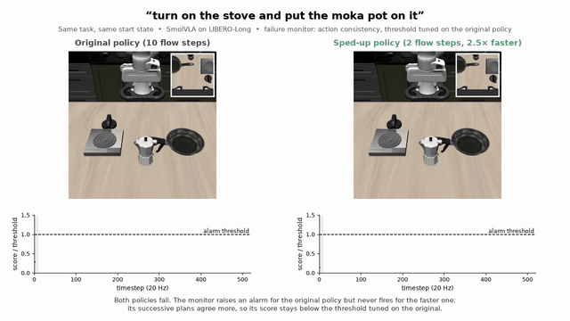

# Does a Robot's Failure Monitor Still Work After a Speed-Up?

Code and results for the CoRL 2026 workshop paper (Efficient Foundation Models for
Real-Time Embodied AI, non-archival). Paper: [`paper/main.pdf`](paper/main.pdf).

Runtime failure monitors for vision-language-action policies are calibrated on the
policy as trained, but the deployed policy is often sped up. We calibrate four monitors
on SmolVLA (two hidden-state probes, a Mahalanobis OOD score, action-chunk consistency),
then run sped-up policies closed loop on LIBERO-Long with the monitors unchanged.
Sampling each action chunk in 2 flow steps instead of 10 is 2.5x faster with no observed
drop in success, but the action-consistency monitor goes from catching 49% of failures to
none, while its false alarms also fall to zero.

## Conditions

| name in code | name in paper | what it is |
|---|---|---|
| `ref` | original | the `HuggingFaceVLA/smolvla_libero` checkpoint as shipped |
| `w8` | int8 | simulated round-to-nearest weights, one scale per output channel |
| `steps2` | 2 steps | 2 flow-matching Euler steps instead of 10, weights untouched |
| `w4g32` | int4-g32 | simulated int4, one scale per 32 weights (post hoc) |
| `w4` | int4-coarse | pre-registered as int4 g128; in fact per-row for 62% of weights (see `NOTES.md`) |
| `ref_a10` | (setup text) | the original executing 10 actions per plan instead of 1; success only, camera-ready check |

## Sample videos

`media/` holds side-by-side clips of the original and 2-step policies on the same task and start state. Each clip shows both camera views and the action-consistency monitor's score against the threshold tuned on the original:

- `fail_task2_init42.mp4`: both fail. The monitor alarms for the original at step 100 and never fires for the 2-step policy.
- `fail_task4_init45.mp4`: the same pattern on a second task.
- `success_task2_init46.mp4`: both succeed, and neither alarms.

Each clip also has a `.gif`, a `_still.png` and a `_filmstrip.png`/`.pdf`.

The frames come from replaying the recorded actions (`modal run modal_app.py --stage replay ...`), so they are the episodes the paper scored. `media.py` builds the clips.

## Files

- `PREREG.md`: hypotheses, splits, monitors and decision rules, frozen before data collection
- `rollout.py`: LeRobot rollouts with compression and feature hooks (runs on Modal)
- `modal_app.py`: smoke / collect / fetch stages
- `monitors.py`, `analyze.py`: monitors, conformal thresholds, pre-registered evaluation
- `robustness.py`, `explore.py`: exploratory and review-driven analyses
- `figures.py`: paper figures; `media.py`: sample videos and stills
- `success_diff.py`: paired success changes (2 steps, 10-action schedule) cited in the camera-ready
- `results/main/`: all numbers reported in the paper
- `RESULTS.md`: summary of results; `NOTES.md`: running log, including review findings

Raw rollouts (`data/`, ~1.9 GB) are not in the repo.
